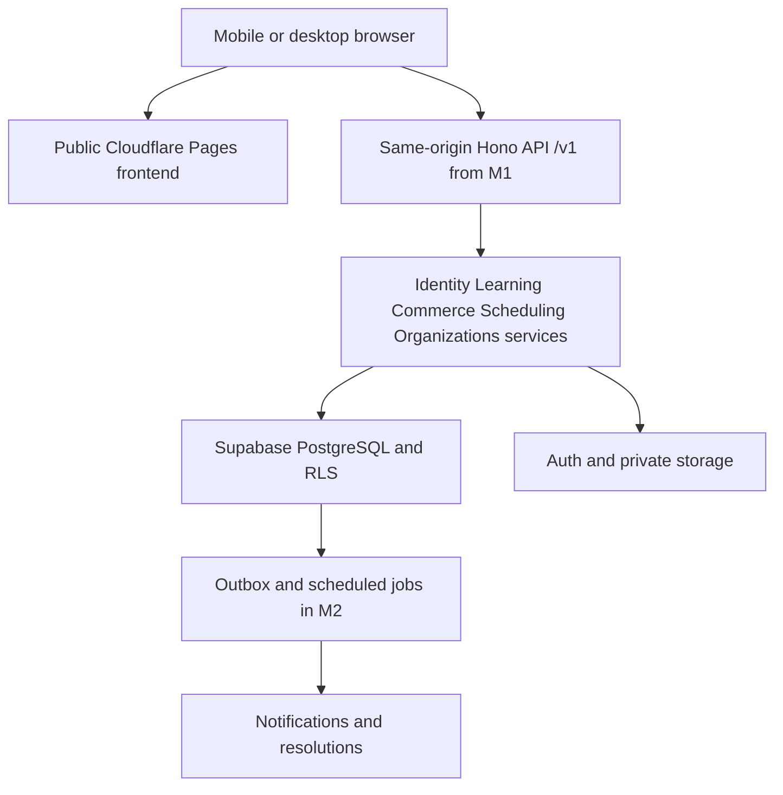

# Architecture and stack

Detailed decisions: ADR-001 to ADR-005. F0 installs the frontend and documentation checks; M1/M2 services remain to be implemented.

## Selected stack

| Layer | Choice | Reason / activation |
| --- | --- | --- |
| Development runtime | Node 24 LTS, npm 11, lockfile | Supported runtime and reproducible installation |
| Frontend | React, strict TypeScript, Vite | Shared ecosystem, fast static build |
| Styling | CSS tokens, local Fraunces/Inter in M0 | Explicit brand, few dependencies, accessibility |
| Animation | Motion for React + CSS | Useful transitions and reduced motion |
| Routing / data | React Router, TanStack Query in M0/M1 as needed | Stable links and controlled cache; no initial global store |
| Validation | Zod in M0/M1, shared schemas | Validated input/content; safe errors |
| M1 API | Hono TypeScript, Cloudflare Worker | Modular REST API, same repository, Web APIs |
| M1 database | PostgreSQL via Supabase, SQL migrations | Transactions, constraints, RLS, portable exports |
| M1 identity | Supabase Auth behind the BFF API | Managed email/MFA; application HttpOnly sessions |
| M1/M2 storage | Private Supabase Storage | Controlled access, short-lived signed URLs |
| M2 asynchronous work | PostgreSQL outbox + scheduled worker | Event in the same commit; idempotent retries |
| Verification | node:test (tooling), TypeScript, ESLint, Playwright; pgTAP/integration in M1 | Verify invariants and critical journeys |
| Delivery | GitHub Actions, Cloudflare Pages in M0 | Preview/build; controlled publication |

Actual resolved versions are in package-lock.json, never inferred from an article. Add dependencies only in tickets that use them. No Redis, microservices, broker or additional orchestration without measurements.

## Flow

M0 serves only public content versioned at build time, without a backend. In M1, migrate frontend hosting to **Workers Static Assets with the /v1 API on the same origin** (ADR-002), keeping cookies and CSRF simple. No cross-site sessions across two provider subdomains. The Worker routes /v1 before the SPA fallback. M0 prerendering remains reusable.

## Target code organization

- `apps/web/src/`: pages, components, i18n, HTTP adapters; no authoritative authorization rules.
- `apps/api/src/modules/{identity,learning,commerce,scheduling,organizations,support}/`: business services; routes validate, authenticate and delegate.
- `packages/contracts/`: secret-free exchange schemas, generated/validated against OpenAPI; created in JUV-202.
- `packages/design/`: tokens and contrast pairs.
- `supabase/migrations/`: schema, constraints, policies and transactional functions.
- `tests/`: scenarios across layers, fictional data.

Frontend → contracts → API → domain → adapters. No React component imports in the domain, no Supabase calls from components to bypass the API. External services do not determine business entitlements.

## Critical transactions

A booking, financial confirmation and invoice issuance each use a single DB transaction exposed through a controlled SQL function/RPC. Do not simulate a transaction through successive HTTP requests. The actor comes from verified identity; the client never supplies an authoritative `checker_id`.

Ordinary queries: user JWT to PostgREST, RLS and restrictive grants. Privileged access: isolated server adapter, additional current-role checks, no secrets in the bundle. Use SECURITY DEFINER only when needed, with fixed `search_path`, minimal EXECUTE rights, internal checks and direct-call tests.

## Scalability

Explicit ports for auth, files, email and clock. Domain and migrations remain portable. Hosting the Hono API elsewhere is possible but requires testing. No promise of a million concurrent users; measure active users, requests and media separately.
