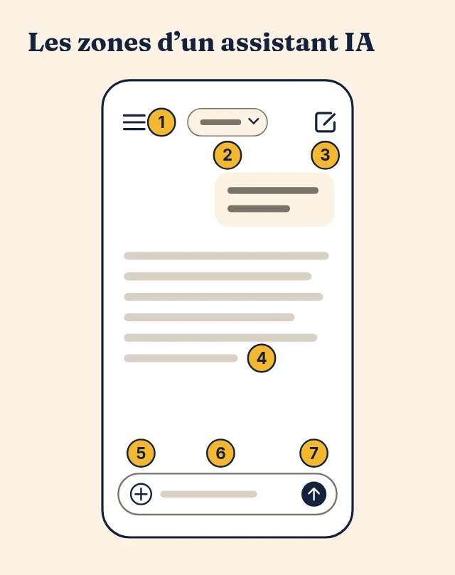
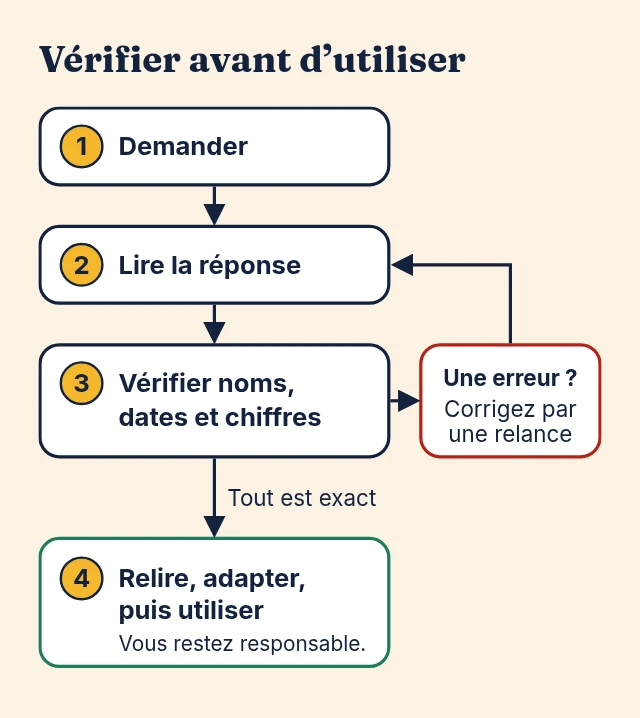

# Course review — premiers-pas-ia v1

Generated from [the canonical French draft](../../content/drafts/premiers-pas-ia/v1.json) by `npm run course:review`. Do not edit this view; edit the JSON and regenerate.

Status: `draft`. The French text in block quotes is learner-facing product content. English headings organize this review document and are not application copy.

## Reviewer instructions

The project owner is the designated reviewer. Read every lesson, try each exercise before its solution, check every criterion, and report unclear instructions or incorrect answers. Record whether you completed the full walkthrough yourself without co-authoring the course. Plan approval is separate from complete-lesson review. This file is a review copy, not a working learner application.

## Course introduction

> # Premiers pas avec l’IA : comprendre ChatGPT et Claude

> Découvrez ce qu’un assistant IA sait faire, créez votre compte gratuit, écrivez des demandes claires, vérifiez les réponses et protégez vos informations\. Six étapes courtes, avec de vrais exercices dans ChatGPT ou Claude, sans compte Juvanga\.

### Objectives

> 1. Comprendre ce qu’un assistant IA fait bien et ce qu’il fait mal\.
> 2. Utiliser l’interface de ChatGPT ou de Claude et régler sa confidentialité\.
> 3. Écrire une demande claire en quatre éléments\.
> 4. Vérifier et corriger une réponse avant de l’utiliser\.
> 5. Protéger les informations personnelles et confidentielles\.

### Prerequisites

> 1. Un téléphone ou un ordinateur avec un navigateur\.
> 2. Une adresse e-mail pour créer un compte gratuit sur ChatGPT ou Claude\.
> 3. Aucun compte Juvanga, aucun paiement et aucune connaissance technique\.

## Lesson 1

> ## Créer votre compte et découvrir l’interface

### Objectives

> 1. Créer un compte gratuit sur le site ou l’application officielle de ChatGPT ou de Claude\.
> 2. Repérer les sept zones principales de l’interface\.
> 3. Choisir en connaissance de cause si vos conversations servent à entraîner le modèle\.

### Teaching content

> Bienvenue\. Ce cours gratuit vous apprend à utiliser ChatGPT ou Claude pour des tâches simples de bureau : rédiger, reformuler, résumer, organiser\. Vous travaillerez avec un vrai assistant, sur des exemples fictifs, sans jamais y mettre de document réel\.

> Le cours entier dure environ 1 h 30, en six étapes courtes ; vous pouvez vous arrêter entre deux leçons\. Prévoyez 15 à 20 minutes pour celle-ci\. Choisissez un seul outil : ChatGPT ou Claude\. Les deux fonctionnent de la même manière pour ce que nous allons faire\.

> Juvanga n’est affilié ni à OpenAI \(ChatGPT\) ni à Anthropic \(Claude\)\. Nous présentons ces outils parce qu’ils sont disponibles au Cameroun et utilisables gratuitement\.

> Utilisez uniquement le site officiel, chatgpt\.com ou claude\.ai, ou l’application officielle publiée par OpenAI ou Anthropic dans votre magasin d’applications\. Des applications imitent ces noms pour collecter des données ou faire payer\.

> ### Créer votre compte en cinq étapes

> 1. Ouvrez chatgpt\.com ou claude\.ai dans votre navigateur, ou l’application officielle\.
> 2. Choisissez l’inscription avec une adresse e-mail\. Vous pouvez utiliser une adresse personnelle\.
> 3. Saisissez le code reçu par e-mail pour confirmer votre adresse\.
> 4. Indiquez votre prénom et confirmez que vous êtes majeur si l’outil le demande\.
> 5. Restez sur l’offre gratuite\. Aucun paiement n’est nécessaire pour ce cours\.

> ### Les sept zones à connaître

> Illustration \(auto, 640×809\) — Schéma d’un assistant IA sur téléphone, avec sept repères numérotés : 1 menu et historique, 2 choix du modèle, 3 nouvelle conversation, 4 zone des réponses, 5 joindre un fichier, 6 champ de saisie, 7 envoyer\.

> 1. Menu et historique : vos anciennes conversations, et l’accès aux paramètres de votre compte\.
> 2. Choix du modèle : la version de l’assistant\. Gardez celle proposée par défaut\.
> 3. Nouvelle conversation : repartir d’une page vide, sans le contexte précédent\.
> 4. Zone des réponses : vos messages et les réponses de l’assistant\.
> 5. Joindre un fichier : ajouter un document ou une image\. Ne l’utilisez jamais avec un document réel confidentiel\.
> 6. Champ de saisie : l’endroit où vous écrivez votre demande\.
> 7. Envoyer : transmettre la demande à l’assistant\.

> ### Régler la confidentialité

> Sur les offres gratuites, vos conversations peuvent servir à améliorer les futurs modèles\. Ce réglage se trouve dans les paramètres, accessibles depuis le menu \(1\) ou depuis votre nom\.

> - ChatGPT : Paramètres, puis Gestion des données, puis l’option d’amélioration du modèle\.
> - Claude : Paramètres, puis Confidentialité, puis l’option « Aider à améliorer Claude »\.

> Astuce — Pour un usage professionnel, nous vous conseillons de désactiver cette option\. Même désactivée, elle ne rend pas l’outil adapté aux documents confidentiels : la leçon 5 y revient\.

### Guided example

> Exemple : vous avez parlé d’un e-mail de report de réunion, puis vous voulez rédiger une note sur un tout autre sujet\. Ouvrez une nouvelle conversation \(3\) : l’assistant ne mélangera pas les deux sujets\.

### Exercise

> Créez votre compte, réglez la confidentialité et menez une première conversation que vous supprimerez ensuite\.

> 1. Créez votre compte gratuit en suivant les cinq étapes de la leçon\.
> 2. Ouvrez les paramètres et choisissez consciemment l’option d’amélioration du modèle\.
> 3. Ouvrez une nouvelle conversation et envoyez : « Bonjour\. Présentez-vous en deux phrases et dites ce que vous ne pouvez pas faire\. »
> 4. Retrouvez cette conversation dans l’historique, renommez-la « Essai Juvanga », puis supprimez-la\.
> 5. Vérifiez chaque critère\.

### Self-assessment criteria

> 1. Mon compte est créé sur le site ou l’application officielle, sans paiement\.
> 2. J’ai ouvert le réglage de confidentialité et fait un choix conscient\.
> 3. J’ai utilisé le champ de saisie, l’envoi, la nouvelle conversation et l’historique\.
> 4. J’ai renommé puis supprimé la conversation d’essai\.

### Worked solution — read after attempting the exercise

> L’assistant se présente généralement comme un programme d’IA et cite quelques limites : il peut se tromper, il ne connaît pas les événements très récents sans recherche, il ne remplace pas un professionnel\. La formulation exacte varie : c’est normal\.

> Renommer et supprimer se fait depuis l’historique \(1\), souvent avec les trois points ou un appui long sur la conversation\. Supprimer une conversation la retire de votre historique\.

## Lesson 2

> ## Comprendre ce que fait un assistant IA, et ce qu’il ne fait pas

### Objectives

> 1. Expliquer en une phrase ce qu’est un assistant IA comme ChatGPT ou Claude\.
> 2. Distinguer les tâches utiles, les tâches à vérifier et les tâches à éviter\.

### Teaching content

> Prévoyez 12 à 15 minutes\. Vous avez maintenant un compte : voyons ce que l’assistant sait faire, et où il peut vous tromper\.

> ### Un assistant IA, qu’est-ce que c’est ?

> Un assistant IA est un programme qui produit du texte à partir de votre demande\. Il a appris sur une très grande quantité de textes\. Il écrit vite et de façon fluide, mais il ne « sait » pas les choses comme une personne : il produit la suite la plus probable\.

> - Il peut rédiger un brouillon correct en quelques secondes\.
> - Il peut aussi affirmer une chose fausse avec assurance\. On parle d’« hallucination »\.
> - Il ne connaît pas votre organisation, vos collègues ni vos dossiers, sauf si vous les lui donnez\.
> - Vous restez responsable de tout ce que vous utilisez\.

> Illustration \(auto, 640×961\) — Trois catégories de tâches\. Utile : rédiger un premier jet, reformuler ou corriger un texte, résumer un texte que vous fournissez, structurer des idées\. Utile si vous vérifiez : chiffres, dates et calculs, faits récents ou textes réglementaires, références et citations\. À éviter : décider à votre place en matière de RH, de droit ou de finances, traiter des données confidentielles, parler de votre organisation qu’il ne connaît pas\.

> ### Une règle simple

> Plus une erreur coûterait cher, plus vous devez vérifier\. Un titre de note mal choisi se corrige vite ; un montant ou un article de loi faux peut causer un vrai problème\.

> Astuce — Pensez à l’assistant comme à un stagiaire rapide et cultivé : très utile pour un premier jet, mais vous relisez tout avant de signer\.

### Guided example

> Exemple : vous demandez « Combien d’agents travaillent à la direction des affaires générales de l’Office fictif des archives du Littoral ? »

> Cet office n’existe pas\. Un bon assistant répond qu’il ne dispose pas de cette information\. Un assistant peut aussi inventer un chiffre plausible, par exemple « environ 45 agents »\. Les deux réponses sont possibles : c’est pour cela qu’on ne lui confie pas une information qu’il ne peut pas connaître\.

### Exercise

> Observez un assistant face à une question qu’il ne peut pas connaître, puis classez six tâches de bureau\.

> 1. Ouvrez ChatGPT ou Claude avec le compte créé à la leçon 1\.
> 2. Envoyez cette question : « Quel est le numéro de téléphone du service courrier de l’Office fictif des archives du Littoral ? »
> 3. Notez ce que fait l’assistant : dit-il qu’il ne sait pas, ou propose-t-il un numéro ?
> 4. Classez ensuite chaque tâche en « utile », « utile si vous vérifiez » ou « à éviter » : 1\. proposer trois titres pour une note d’information ; 2\. résumer un rapport que vous lui fournissez ; 3\. donner le nombre d’agents de votre direction ; 4\. calculer le total d’un tableau de dépenses ; 5\. citer l’article de loi qui encadre les congés ; 6\. décider quel agent doit être sanctionné\.
> 5. Comparez avec le corrigé, puis vérifiez chaque critère\.

### Self-assessment criteria

> 1. J’ai posé la question dans un vrai assistant et noté s’il a reconnu ne pas savoir ou s’il a inventé\.
> 2. Mes six classements correspondent au corrigé, ou je sais expliquer chaque différence\.
> 3. Je sais dire pourquoi un numéro proposé par l’assistant ne doit pas être utilisé sans vérification\.

### Worked solution — read after attempting the exercise

> Question sur l’office fictif : un numéro proposé serait forcément inventé, puisque l’office n’existe pas\. Si l’assistant a répondu qu’il ne savait pas, c’est le bon comportement ; si ce n’est pas le cas, vous venez de voir une hallucination\.

> - 1\. Proposer trois titres : utile\.
> - 2\. Résumer un rapport fourni : utile\. Il travaille sur votre texte\.
> - 3\. Nombre d’agents de votre direction : à éviter\. Il ne connaît pas votre organisation\.
> - 4\. Total d’un tableau de dépenses : utile si vous vérifiez\. Les calculs peuvent être faux\.
> - 5\. Article de loi sur les congés : utile si vous vérifiez\. Il peut se tromper de texte ou de numéro\.
> - 6\. Décider d’une sanction : à éviter\. C’est une décision humaine et encadrée\.

> Un numéro, un nom ou un montant venant de l’assistant n’a aucune valeur tant que vous ne l’avez pas confirmé à une source fiable\.

## Lesson 3

> ## Écrire une demande claire

### Objectives

> 1. Rédiger une demande avec un contexte, une demande, un format et des limites\.
> 2. Comparer la réponse à une demande vague et à une demande structurée\.

### Teaching content

> Prévoyez 15 à 20 minutes\. La qualité de la réponse dépend surtout de la qualité de votre demande\. On appelle aussi cette demande un « prompt »\.

> Illustration \(auto, 640×806\) — Les quatre éléments d’une demande claire\. 1 Contexte : « Je travaille au secrétariat de direction d’un office public à Douala\. » 2 Demande : « Rédigez un e-mail qui reporte la réunion de lundi\. » 3 Format : « Cinq phrases au maximum, sur un ton courtois\. » 4 Limites : « N’inventez pas de date : écrivez \[DATE À CONFIRMER\]\. »

![Les quatre éléments d’une demande claire\. 1 Contexte : « Je travaille au secrétariat de direction d’un office public à Douala\. » 2 Demande : « Rédigez un e-mail qui reporte la réunion de lundi\. » 3 Format : « Cinq phrases au maximum, sur un ton courtois\. » 4 Limites : « N’inventez pas de date : écrivez \[DATE À CONFIRMER\]\. »](../../content/drafts/premiers-pas-ia/media/n0-request-card.webp)

> 1. Contexte : qui vous êtes et la situation\. L’assistant ne la devine pas\.
> 2. Demande : ce que vous voulez obtenir, avec un verbe d’action : rédigez, résumez, reformulez, proposez\.
> 3. Format : la longueur, le ton, la présentation \(liste, tableau, e-mail\)\.
> 4. Limites : ce qu’il ne doit pas faire ou inventer\.

> Une demande n’a pas besoin d’être parfaite du premier coup\. Vous pourrez préciser ensuite par une relance, comme dans une conversation\.

> Astuce — Quand une information manque, demandez à l’assistant d’écrire un repère comme \[DATE À CONFIRMER\] plutôt que de deviner\.

### Guided example

> Demande vague : « Écris un mail pour reporter la réunion\. » La réponse risque d’inventer une date, un motif et un ton qui ne vous conviennent pas\.

> Demande structurée : « Je travaille au secrétariat de direction d’un office public à Douala\. Rédigez un e-mail aux chefs de service pour reporter la réunion de coordination prévue lundi à 10 h, car la salle n’est pas disponible\. Cinq phrases au maximum, ton courtois\. N’inventez pas de nouvelle date : écrivez \[DATE À CONFIRMER\]\. »

### Exercise

> Envoyez une demande vague puis une demande structurée, et comparez les deux réponses\.

> 1. Ouvrez une nouvelle conversation et envoyez : « Écris un mail pour reporter la réunion\. »
> 2. Ouvrez une autre nouvelle conversation\. Écrivez votre propre demande structurée pour la même situation : réunion de coordination lundi à 10 h, salle indisponible, nouvelle date inconnue\.
> 3. Vérifiez que votre demande contient les quatre éléments avant de l’envoyer\.
> 4. Comparez les deux réponses et notez au moins deux différences\.
> 5. Comparez avec le corrigé, puis vérifiez chaque critère\.

### Self-assessment criteria

> 1. Ma demande structurée contient un contexte, une demande, un format et des limites\.
> 2. Ma demande interdit d’inventer la nouvelle date\.
> 3. J’ai noté au moins deux différences entre les deux réponses\.

### Worked solution — read after attempting the exercise

> Exemple de demande : « Je travaille au secrétariat de direction d’un office public à Douala\. Rédigez un e-mail aux chefs de service pour reporter la réunion de coordination prévue lundi à 10 h, car la salle n’est pas disponible\. Cinq phrases au maximum, ton courtois et professionnel\. N’inventez pas de nouvelle date : écrivez \[DATE À CONFIRMER\]\. »

> - La réponse vague invente souvent une date, un motif ou des destinataires\.
> - La réponse structurée respecte la longueur et le ton demandés\.
> - La réponse structurée garde le repère \[DATE À CONFIRMER\] au lieu de deviner\.

> Vos réponses ne seront pas identiques à celles d’un collègue : l’assistant varie ses formulations\. Ce qui compte, c’est que la réponse respecte vos quatre éléments\.

## Lesson 4

> ## Vérifier et améliorer la réponse

### Objectives

> 1. Contrôler chaque nom, date et chiffre d’une réponse à partir de la source\.
> 2. Corriger une réponse par des relances précises\.

### Teaching content

> Prévoyez 15 à 20 minutes\. Un texte bien écrit n’est pas forcément exact\. Avant d’utiliser une réponse, vous la comparez à vos informations de départ\.

> Illustration \(auto, 640×718\) — Boucle de vérification : 1 demander, 2 lire la réponse, 3 vérifier noms, dates et chiffres\. En cas d’erreur, corriger par une relance, puis relire\. Si tout est exact, 4 relire, adapter, puis utiliser : vous restez responsable\.

> ### Ce qu’il faut vérifier en priorité

> - Les noms, les fonctions et les services\.
> - Les dates, les heures et les lieux\.
> - Les chiffres, les montants et les calculs\.
> - Tout ajout qui ne figure pas dans vos informations : un engagement, une obligation, une personne\.

> ### Corriger par une relance

> Répondez dans la même conversation, en citant précisément le problème\. Par exemple : « La formation a lieu en salle B2, pas en salle B1\. Corrigez seulement ce point\. » Une relance précise évite que l’assistant réécrive tout le texte\.

> Ne transmettez jamais un texte produit par l’assistant sans l’avoir relu en entier\. C’est votre nom qui figure sur le document\.

### Guided example

> Informations de départ : formation bureautique pour 12 agents, mardi et mercredi de 9 h à 12 h, salle B2, inscription auprès du service des ressources humaines avant vendredi\.

> Extrait de réponse : « Une formation obligatoire en bureautique est organisée pour 15 agents, mardi et mercredi de 9 h à 12 h, en salle B2\. »

> Vérification : « 15 agents » est faux, la source dit 12\. « Obligatoire » est un ajout : la source ne le dit pas\. Relance : « Il s’agit de 12 agents et la formation n’est pas présentée comme obligatoire\. Corrigez ces deux points\. »

### Exercise

> Faites rédiger une courte note d’information, trouvez au moins deux problèmes et corrigez-les par des relances\.

> 1. Ouvrez une nouvelle conversation\. Envoyez une demande structurée pour une note d’information au personnel, avec ces faits : formation bureautique pour 12 agents, mardi et mercredi de 9 h à 12 h, salle B2, inscription auprès du service des ressources humaines avant vendredi\.
> 2. Comparez chaque nom, date, heure, lieu et chiffre de la réponse avec ces faits\.
> 3. Si vous ne trouvez aucun problème, envoyez : « Ajoutez le nom du formateur\. » Ce nom ne figure pas dans les faits : observez si l’assistant l’invente\.
> 4. Corrigez chaque problème par une relance précise, puis relisez la version finale\.
> 5. Comparez avec le corrigé, puis vérifiez chaque critère\.

### Self-assessment criteria

> 1. J’ai comparé chaque nom, date, heure, lieu et chiffre avec les faits\.
> 2. J’ai repéré au moins deux problèmes, ou provoqué et repéré une invention\.
> 3. J’ai corrigé chaque problème par une relance précise\.
> 4. La version finale ne contient rien qui ne figure pas dans les faits\.

### Worked solution — read after attempting the exercise

> - Un chiffre modifié : 15 ou 20 agents au lieu de 12\.
> - Un ajout : formation « obligatoire », « certifiante » ou « gratuite »\.
> - Une invention : un nom de formateur, un numéro de téléphone, une date précise pour vendredi\.
> - Un détail déplacé : une autre salle ou d’autres horaires\.

> Exemple de relance : « Le formateur n’est pas connu\. Retirez son nom et ne mettez aucune personne à sa place\. »

> Version finale correcte : une note qui reprend exactement les quatre faits, sans rien ajouter\. Si l’assistant a inventé un nom, vous avez vu pourquoi cette étape est indispensable\.

## Lesson 5

> ## Protéger les informations

### Objectives

> 1. Reconnaître les informations qu’il ne faut jamais coller dans un assistant public\.
> 2. Anonymiser un texte avant de demander de l’aide\.

### Teaching content

> Prévoyez 10 à 15 minutes\. Tout ce que vous écrivez dans un assistant quitte votre ordinateur et est traité par l’entreprise qui le fournit, souvent hors du Cameroun\.

> Illustration \(auto, 640×721\) — Ne collez jamais : mots de passe et codes d’accès ; données personnelles comme les noms, téléphones, numéros de CNI ou salaires ; documents confidentiels ou classifiés ; dossiers de clients ou d’usagers\. Remplacez par : des rôles comme « le chef de service » ; des repères comme \[NOM\], \[MONTANT\], \[DATE\] ; des exemples fictifs\.

![Ne collez jamais : mots de passe et codes d’accès ; données personnelles comme les noms, téléphones, numéros de CNI ou salaires ; documents confidentiels ou classifiés ; dossiers de clients ou d’usagers\. Remplacez par : des rôles comme « le chef de service » ; des repères comme \[NOM\], \[MONTANT\], \[DATE\] ; des exemples fictifs\.](../../content/drafts/premiers-pas-ia/media/n0-never-paste.webp)

> ### Anonymiser en trois gestes

> 1. Repérez chaque information qui permet d’identifier une personne ou de révéler un dossier\.
> 2. Remplacez-la par un rôle ou un repère entre crochets : \[NOM\], \[MATRICULE\], \[MONTANT\]\.
> 3. Relisez : une personne extérieure pourrait-elle reconnaître quelqu’un ? Si oui, continuez\.

> Quand l’assistant a produit le texte, vous remettez vous-même les vraies informations dans votre document, hors de l’assistant\.

> Si votre organisation a une règle sur l’usage de l’IA, elle passe avant ce cours\. En cas de doute sur un document, ne le collez pas\.

> Les informations de santé, de sanction ou de salaire sont particulièrement sensibles\. Même anonymisées, réfléchissez avant de les utiliser\.

### Guided example

> Avant : « M\. Exemple Paul, matricule 000 000, a demandé une avance de 150 000 FCFA\. »

> Après : « \[NOM\], matricule \[MATRICULE\], a demandé une avance de \[MONTANT\]\. » L’assistant peut maintenant vous aider à rédiger la réponse sans connaître la personne\.

### Exercise

> Anonymisez un court texte fictif, puis demandez à l’assistant de le transformer en note courtoise\.

> 1. Texte fictif : « Mme Modèle Alice, matricule 111 222, téléphone 6 00 00 00 00, est en congé maladie du 3 au 14 mars\. Son salaire de 245 000 FCFA est maintenu\. Merci d’informer son équipe\. »
> 2. Recopiez ce texte sur papier ou dans un éditeur, et remplacez chaque information sensible par un repère\.
> 3. Vérifiez qu’aucune personne ne peut être reconnue\.
> 4. Envoyez la version anonymisée à l’assistant et demandez une note courtoise de trois phrases pour informer l’équipe\.
> 5. Comparez avec le corrigé, puis vérifiez chaque critère\.

### Self-assessment criteria

> 1. Le nom, le matricule et le téléphone sont remplacés par des repères\.
> 2. Le motif médical et le salaire sont retirés ou remplacés\.
> 3. Seule la version anonymisée a été envoyée à l’assistant\.
> 4. La note obtenue informe l’équipe sans révéler d’information personnelle\.

### Worked solution — read after attempting the exercise

> Version anonymisée : « \[NOM\] sera absent\(e\) du \[DATE DE DÉBUT\] au \[DATE DE FIN\]\. Merci d’informer son équipe\. » Le motif médical et le salaire n’ont pas besoin d’être connus de l’équipe : il vaut mieux les retirer que les masquer\.

> Exemple de note : « Chers collègues, nous vous informons que \[NOM\] sera absent\(e\) du \[DATE DE DÉBUT\] au \[DATE DE FIN\]\. Merci d’adresser vos demandes urgentes à \[SUPPLÉANT\] pendant cette période\. Nous vous remercions de votre compréhension\. »

> Vous complétez ensuite les repères vous-même, dans votre propre document\. La note finale ne mentionne toujours ni la maladie ni le salaire\.

## Lesson 6

> ## Exercice final : produire un texte utile

### Objectives

> 1. Combiner demande claire, protection des informations et vérification sur une tâche complète\.

### Teaching content

> Prévoyez environ 15 minutes\. Vous allez réaliser une tâche complète, comme au bureau, en appliquant tout ce que vous avez vu\.

> ### La situation

> Votre chef de service vous demande d’informer le personnel que le bureau courrier sera exceptionnellement fermé jeudi après-midi pour inventaire\. Pendant la fermeture, les plis urgents sont reçus au secrétariat de direction\. Le service reprend normalement vendredi à 8 h\.

> Illustration \(auto, 640×555\) — Cinq vérifications avant d’utiliser le résultat : ma demande donne le contexte, la demande, le format et les limites ; elle ne contient aucune donnée réelle sensible ; j’ai vérifié les noms, les dates et les chiffres ; j’ai relu et adapté le texte moi-même ; le résultat est utilisable sans rien inventer\.

> Essayez — Faites l’exercice dans votre assistant avant de lire le corrigé\. Votre texte sera différent du nôtre, et c’est normal\.

> Ce cours est une autoévaluation\. Il ne délivre ni note ni certification\.

### Guided example

> Rappel des quatre éléments : contexte \(qui écrit et à qui\), demande \(le texte à produire\), format \(longueur, ton, forme\), limites \(ce qu’il ne faut pas inventer : un nom de responsable, une heure de fin, un motif\)\.

### Exercise

> Produisez avec l’assistant une note d’information sur la fermeture du bureau courrier, puis vérifiez-la avec les cinq critères\.

> 1. Ouvrez une nouvelle conversation\.
> 2. Écrivez une demande avec les quatre éléments, à partir de la situation décrite\. N’y mettez aucun vrai nom\.
> 3. Comparez la réponse avec la situation : jour, demi-journée, lieu de dépôt des plis urgents, heure de reprise\.
> 4. Corrigez par relance tout ajout ou toute erreur\.
> 5. Relisez et adaptez le texte final vous-même, puis vérifiez les cinq critères\.

### Self-assessment criteria

> 1. Ma demande donne le contexte, la demande, le format et les limites\.
> 2. Ma demande ne contient aucune donnée réelle sensible\.
> 3. J’ai vérifié le jour, la demi-journée, le lieu de dépôt et l’heure de reprise, et corrigé chaque erreur\.
> 4. J’ai relu et adapté le texte final moi-même\.
> 5. La note peut être diffusée sans inventer d’information\.

### Worked solution — read after attempting the exercise

> Exemple de demande : « Je travaille au secrétariat d’un office public à Douala\. Rédigez une note d’information au personnel : le bureau courrier sera exceptionnellement fermé jeudi après-midi pour inventaire ; pendant la fermeture, les plis urgents sont reçus au secrétariat de direction ; reprise normale vendredi à 8 h\. Quatre phrases au maximum, ton courtois\. N’ajoutez ni nom, ni heure de fermeture précise, ni autre information\. »

> Exemple de note : « Chers collègues, le bureau courrier sera exceptionnellement fermé ce jeudi après-midi pour cause d’inventaire\. Pendant cette fermeture, les plis urgents seront reçus au secrétariat de direction\. Le service reprendra normalement vendredi à 8 h\. Merci de votre compréhension\. »

> Points souvent à corriger : une heure de fermeture inventée \(« à partir de 13 h »\), un nom de responsable ajouté, ou une fermeture étendue à toute la journée\.

> Bravo : vous savez maintenant demander, vérifier et protéger\. La prochaine étape consiste à appliquer ces gestes chaque semaine à une vraie tâche non confidentielle de votre travail\.

## Review record

Report your review and full non-author walkthrough result to the delivery owner; the canonical [verification record](../product/N0-COURSE.md) tracks the current outcome and limitations. No review timestamp or publication date is inferred from reading this file.
